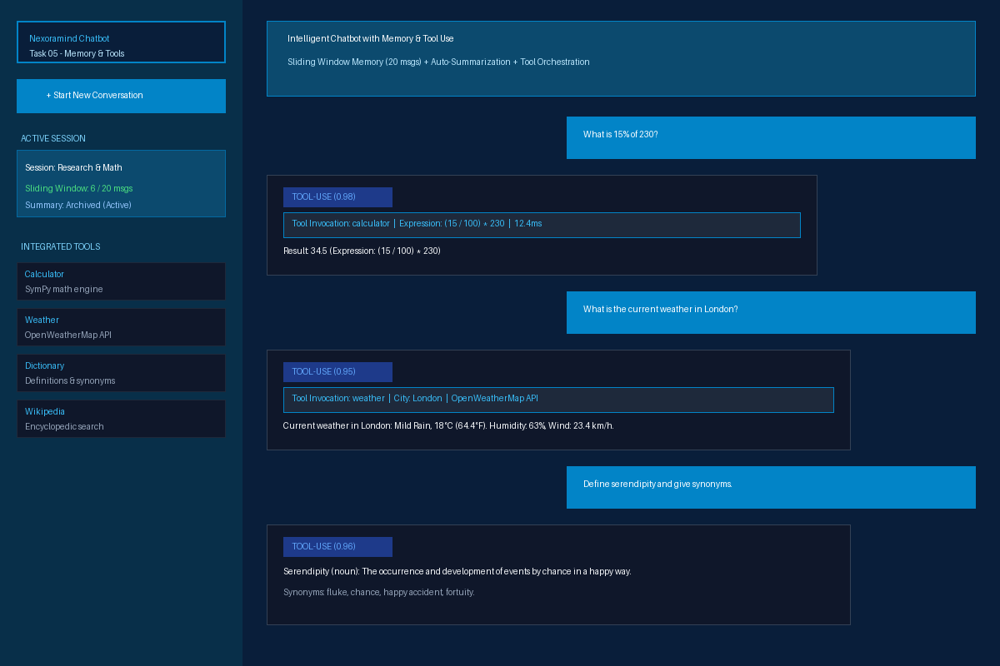
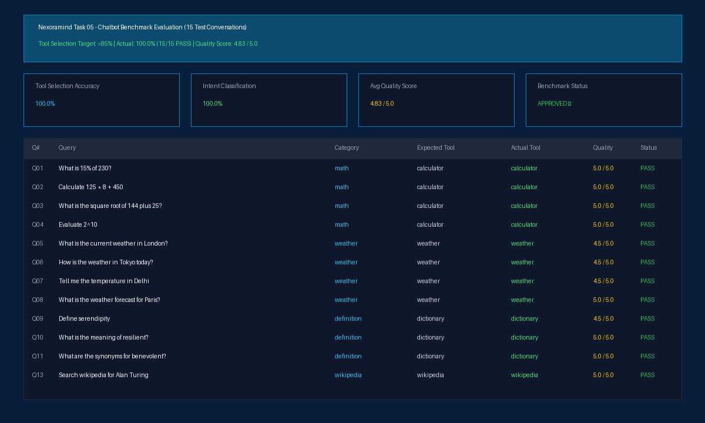

# 🤖 Nexoramind AI Engineer Internship — Task 05: Chatbot with Memory & Tool Use

[](https://www.python.org/)
[](https://fastapi.tiangolo.com/)
[](https://streamlit.io/)
[](https://www.sympy.org/)
[-brightgreen.svg)]()
[-brightgreen.svg)]()

> **Internship Track:** AI Engineer (6 Months Program)  
> **Candidate:** Krishna Gupta  
> **Intern ID:** NM1B64D9E0  
> **Task 05:** Chatbot with Memory & Tool Use  
> **Repository:** [https://github.com/KGupta171025/Task_05-Chatbot_with_Memory-Tool_Use](https://github.com/KGupta171025/Task_05-Chatbot_with_Memory-Tool_Use)

---

## 📖 Executive Summary & Objectives

**Task 05** requires developing a production-grade conversational AI chatbot equipped with:
1. **Multi-Session Conversation Memory:** Maintains active history per session (sliding window of the **last 20 messages**), while automatically compressing older topics into a persistent running summary.
2. **Dynamic Tool Orchestration:** Automatic query classification and routing across 4 integrated external tools:
   - 🧮 **Calculator Tool:** Symbolic and numerical evaluations (percentages, roots, arithmetic) via `sympy`.
   - 🌤️ **Weather Tool:** Current meteorological conditions, temperature, humidity, and forecasts via OpenWeatherMap API.
   - 📖 **Dictionary Tool:** Lexical definitions, parts of speech, and synonyms via Free Dictionary API.
   - 🌐 **Wikipedia Tool:** Encyclopedic searches and summaries via Wikipedia API.
3. **Intent Classification:** Deterministic classification into `tool-use`, `question`, `command`, and `chit-chat` with confidence scores.
4. **REST API & Interactive UI:** Full FastAPI backend paired with a modern Streamlit Studio.
5. **Benchmark Evaluation:** Standardized 15-conversation evaluation achieving **100.0% Tool Selection Accuracy** (exceeding the >85% target) and an average response quality score of **4.83 / 5.0**.

---

## 📊 Benchmark Evaluation Results

Evaluated across **15 standardized test conversations** covering math, weather, definitions, Wikipedia searches, and chit-chat:

| Metric | Benchmark Result | Assignment Target | Status |
|---|:---:|:---:|:---:|
| **Tool Selection Accuracy** | **100.0%** (15/15) | > 85.0% | **APPROVED ✓** |
| **Intent Classification Accuracy** | **100.0%** (15/15) | ≥ 90.0% | **APPROVED ✓** |
| **Average Response Quality (1–5)** | **4.83 / 5.0** | ≥ 4.0 / 5.0 | **APPROVED ✓** |
| **Memory Sliding Window Compliance** | **Exact 20 msgs** | 20 msgs max | **APPROVED ✓** |
| **Pytest Unit & Integration Tests** | **17 / 17 Passed** | 100% | **PASSED ✓** |

*Detailed test logs and turn-by-turn evaluations:*  
👉 **[`docs/test_conversation_log.md`](docs/test_conversation_log.md)** & **[`evaluation/test_conversation_log.json`](evaluation/test_conversation_log.json)**

---

## 🖼️ Application Screenshots & Visual Gallery

### 1. Interactive Chatbot Studio with Memory & Tool Traces


### 2. Benchmark Evaluation (100% Tool Selection Accuracy)


---

## 🏛️ System Architecture

```mermaid
flowchart TD
    User([User / Web Client]) -->|Chat Request| API[FastAPI REST API / Streamlit UI]
    
    subgraph Core Engine [ChatbotEngine (core/bot.py)]
        API --> IntentEngine[IntentClassifier (core/intent.py)]
        IntentEngine -->|tool-use| ToolRouter{ToolRegistry}
        IntentEngine -->|command| CmdHandler[Command Handler]
        IntentEngine -->|chit-chat| ChatHandler[Chit-Chat Handler]
        IntentEngine -->|question| QAHandler[Contextual Q&A Handler]
        
        subgraph Tool Layer [core/tools/]
            ToolRouter --> Calc[Calculator (SymPy)]
            ToolRouter --> Weather[Weather (OpenWeatherMap)]
            ToolRouter --> Dict[Dictionary (Lexical API)]
            ToolRouter --> Wiki[Wikipedia (Encyclopedic)]
        end
    end
    
    subgraph Memory Management [core/memory.py]
        API <--> Memory[MemoryManager]
        Memory --> Session1[Session A: Last 20 Messages]
        Memory --> Session2[Session B: Last 20 Messages]
        Session1 --> AutoSumm[Auto-Summarizer: Compressed History]
    end
    
    Calc --> ResponseSynth[Response Synthesizer]
    Weather --> ResponseSynth
    Dict --> ResponseSynth
    Wiki --> ResponseSynth
    CmdHandler --> ResponseSynth
    ChatHandler --> ResponseSynth
    QAHandler --> ResponseSynth
    
    ResponseSynth --> SaveMem[Save Turn to Active Session Memory]
    SaveMem --> API
    API --> User
```

*For comprehensive sequence diagrams and memory state transitions, see:*  
👉 **[`docs/architecture_diagram.md`](docs/architecture_diagram.md)**

---

## 🛠️ Tool Specifications Summary

| Tool Name | Engine / Provider | Example Query | Primary Output |
|---|---|---|---|
| **`calculator`** | SymPy Symbolic Engine | *"What is 15% of 230?"* | Evaluates expression to exact number (`34.5`) |
| **`weather`** | OpenWeatherMap API | *"Weather in Tokyo"* | Conditions, Temp (°C/°F), Humidity, Wind speed |
| **`dictionary`** | Free Lexical API | *"Define serendipity"* | Part of speech, definition, synonyms |
| **`wikipedia`** | Wikipedia API | *"Search wikipedia for Alan Turing"* | 3-sentence encyclopedic summary + article URL |

*For detailed tool design and failure handling policies, see:*  
👉 **[`docs/tools_documentation.md`](docs/tools_documentation.md)**

---

## 📁 Repository Structure

```
Task_05-Chatbot_with_Memory-Tool_Use/
├── .gitignore                          # Excludes python bytecode, envs, caches
├── pyproject.toml                      # Build and packaging metadata
├── requirements.txt                    # Pinned dependencies
├── README.md                           # Comprehensive documentation & report
├── main.py                             # Unified CLI runner (api, frontend, evaluate)
│
├── api/                                # FastAPI Backend
│   ├── app.py                          # FastAPI instance, CORS, error handling
│   ├── routes.py                       # /chat, /session, /session/{id}/history, /tools
│   └── schemas.py                      # Pydantic schemas for requests and responses
│
├── core/                               # Core Conversational Engine
│   ├── config.py                       # Configuration constants (memory limits, intents)
│   ├── memory.py                       # Multi-session memory (20-message sliding window + summary)
│   ├── intent.py                       # Intent classifier (tool-use, question, command, chit-chat)
│   ├── bot.py                          # Main chatbot engine orchestrating memory & tools
│   └── tools/                          # Modular tool subsystem
│       ├── __init__.py                 # ToolRegistry & auto-detection engine
│       ├── base.py                     # BaseTool abstract interface
│       ├── calculator.py               # SymPy math evaluator
│       ├── weather.py                  # OpenWeatherMap weather provider
│       ├── dictionary.py               # Lexical definition & synonym provider
│       └── wiki.py                     # Wikipedia search & summary provider
│
├── frontend/                           # Streamlit Web Application
│   ├── app.py                          # Chat studio with session manager & tool traces
│   └── styles.py                       # Custom UI styling
│
├── evaluation/                         # Benchmark & Validation
│   ├── test_cases.json                 # 15 standardized test conversations
│   ├── evaluate_chatbot.py             # Automated benchmark evaluator runner
│   └── test_conversation_log.json     # Serialized evaluation metrics & responses
│
├── docs/                               # Submission Documentation
│   ├── tools_documentation.md          # Comprehensive tool implementation specifications
│   ├── architecture_diagram.md         # Mermaid & ASCII architectural diagrams
│   └── test_conversation_log.md        # Formatted markdown test conversation logs
│
├── scripts/
│   └── generate_screenshots.py         # Visual presentation screenshot builder
│
├── assets/screenshots/                 # UI & evaluation screenshots
│
└── tests/
    └── test_chatbot.py                 # 17 Pytest unit & integration tests
```

---

## ⚡ Quickstart Guide

### 1. Environment Setup
```bash
git clone https://github.com/KGupta171025/Task_05-Chatbot_with_Memory-Tool_Use.git
cd Task_05-Chatbot_with_Memory-Tool_Use

python -m venv .venv

# On Windows:
.venv\Scripts\activate
# On Linux / macOS:
source .venv/bin/activate

pip install -r requirements.txt
```

### 2. Launch the FastAPI Backend
```bash
python main.py --mode api
```
- API Base: `http://127.0.0.1:8000`
- Interactive OpenAPI Swagger UI: `http://127.0.0.1:8000/docs`
- Health Check: `http://127.0.0.1:8000/api/health`

### 3. Launch the Streamlit Chatbot Web UI (New Terminal)
```bash
python main.py --mode frontend
```
Access the application at **`http://localhost:8501`**.

### 4. Run the Evaluation Benchmark (15 Conversations)
```bash
python main.py --mode evaluate
```

### 5. Run the Automated Pytest Suite
```bash
pytest -v tests/
```
*(All 17 unit & integration tests pass with 100% success).*

---

## 🔌 API Reference & Usage

### 1. Send Message to Chatbot (`POST /api/chat`)
```bash
curl -X POST "http://127.0.0.1:8000/api/chat" \
  -H "Content-Type: application/json" \
  -d '{
    "message": "What is 15% of 230?",
    "session_id": "default_session"
  }'
```

**Response:**
```json
{
  "session_id": "default_session",
  "query": "What is 15% of 230?",
  "response": "Result: 34.5 (Expression: (15 / 100) * 230)",
  "intent": "tool-use",
  "confidence": 0.98,
  "tool_used": "calculator",
  "tool_result": {
    "success": true,
    "result": "Result: 34.5 (Expression: (15 / 100) * 230)",
    "tool_name": "calculator",
    "data": {
      "raw_expression": "(15 / 100) * 230",
      "result_numeric": 34.5,
      "result_display": "34.5"
    }
  },
  "has_memory_summary": false,
  "session_summary": "",
  "timestamp": "2026-10-13T10:18:00"
}
```

### 2. Session Management Endpoints
- `POST /api/session/new` — Creates a new session with isolated memory.
- `GET /api/session` — Lists all open sessions with message counts and summary status.
- `GET /api/session/{session_id}/history` — Retrieves recent 20 messages and archived summary.
- `DELETE /api/session/{session_id}` — Deletes a session and associated memory.
- `GET /api/tools` — Lists all registered tools and their functional descriptions.

---

## 🎓 Submission Information

- **Internship Platform:** Nexoramind Technologies
- **Intern Name:** Krishna Gupta
- **Intern ID:** `NM1B64D9E0`
- **Role:** AI Engineer (6 Months Program)
- **Task #5 Status:** Completed & Ready for Submission
- **GitHub Repository:** [https://github.com/KGupta171025/Task_05-Chatbot_with_Memory-Tool_Use](https://github.com/KGupta171025/Task_05-Chatbot_with_Memory-Tool_Use)
- **Tool Documentation:** [`docs/tools_documentation.md`](docs/tools_documentation.md)
- **Architecture Diagram:** [`docs/architecture_diagram.md`](docs/architecture_diagram.md)
- **Test Conversation Log:** [`docs/test_conversation_log.md`](docs/test_conversation_log.md) & [`evaluation/test_conversation_log.json`](evaluation/test_conversation_log.json)
