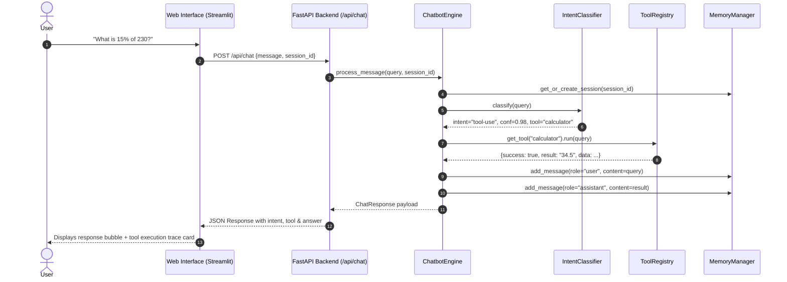

# 🏛️ System Architecture Documentation

**Project:** Nexoramind Task 05 — Intelligent Chatbot with Memory & Tool Use  
**Author:** Krishna Gupta | **Intern ID:** NM1B64D9E0  

---

## 1. High-Level Architecture Diagram

```mermaid
flowchart TD
    User([User / Evaluator]) -->|HTTP Request| API[FastAPI REST API / Streamlit UI]
    
    subgraph Core Engine [ChatbotEngine (core/bot.py)]
        API --> IntentEngine[IntentClassifier (core/intent.py)]
        IntentEngine -->|1. tool-use| ToolRouter{ToolRegistry}
        IntentEngine -->|2. command| CmdHandler[Command Handler]
        IntentEngine -->|3. chit-chat| ChatHandler[Chit-Chat Handler]
        IntentEngine -->|4. question| QAHandler[Contextual Q&A Handler]
        
        subgraph Tool Layer [core/tools/]
            ToolRouter --> Calc[Calculator (SymPy)]
            ToolRouter --> Weather[Weather (OpenWeatherMap)]
            ToolRouter --> Dict[Dictionary (Lexical API)]
            ToolRouter --> Wiki[Wikipedia (Encyclopedic)]
        end
    end
    
    subgraph Memory Management [core/memory.py]
        API <--> Memory[MemoryManager]
        Memory --> Session1[Session A: Last 20 Messages]
        Memory --> Session2[Session B: Last 20 Messages]
        Session1 --> AutoSumm[Auto-Summarizer: Compressed History]
    end
    
    Calc --> ResponseSynth[Response Synthesizer]
    Weather --> ResponseSynth
    Dict --> ResponseSynth
    Wiki --> ResponseSynth
    CmdHandler --> ResponseSynth
    ChatHandler --> ResponseSynth
    QAHandler --> ResponseSynth
    
    ResponseSynth --> SaveMem[Save Turn to Active Session Memory]
    SaveMem --> API
    API --> User
```

---

## 2. Conversation Memory Architecture

The chatbot satisfies all assignment memory requirements via `MemoryManager` and `Session` in `core/memory.py`:

```
User Message ──► [ Active Message List ] (Current window size: N)
                        │
                  Is N > 20 ?
                 /           \
               Yes            No
               /               \
       [ Slice Oldest ]       [ Keep Active ]
             │
      [ Auto-Summarizer ]
             │
   [ Append to session.summary ]
```

1. **Sliding Window:** Exactly the most recent **20 messages** (`MAX_HISTORY_MESSAGES = 20`) are retained in active memory for immediate conversational referencing.
2. **Context Compression:** When message counts exceed 20, the older messages are automatically summarized into `session.summary` to stay strictly within LLM context limitations without losing topical continuity.
3. **Session Management:**
   - `POST /api/session/new` — Starts a new conversation session with isolated memory state.
   - `GET /api/session` — Lists all open sessions with message counts and summary indicators.
   - `GET /api/session/{id}/history` — Retrieves recent 20 messages plus archived summary.
   - `DELETE /api/session/{id}` — Clears a session completely.

---

## 3. Intent Classification Pipeline

The `IntentClassifier` evaluates queries across 4 discrete intent categories with explicit confidence scores:

| Intent Category | Identification Heuristic | Confidence Range | Target Handler |
|---|---|:---:|---|
| **`tool-use`** | Math patterns, weather phrasing, dictionary definitions, Wikipedia searches | `0.90 – 0.98` | Dispatches to `ToolRegistry` |
| **`command`** | System keywords (`clear`, `reset`, `show tools`, `help`, `list sessions`) | `0.85 – 0.95` | Executes session / tool management |
| **`chit-chat`** | Greetings, pleasantries, small talk (`hello`, `how are you`, `who are you`) | `0.85 – 0.96` | Returns natural conversational small-talk |
| **`question`** | Open-ended conceptual inquiries (`Why is the sky blue?`, `Explain photosynthesis`) | `0.75 – 0.90` | Evaluates question with session history |

---

## 4. End-to-End Sequence Diagram


